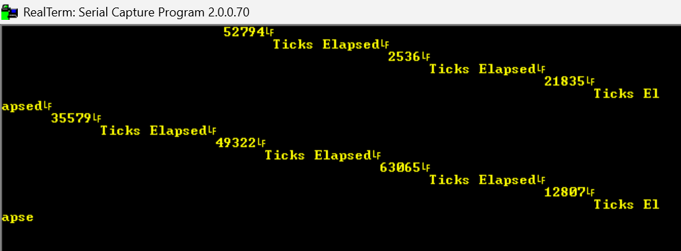

# STM32H7 SysTick Driver

A register-level driver for the ARM Cortex-M7 SysTick timer on the STM32H7A3 
(Nucleo-H7A3ZI-Q), built directly against RM0455 without HAL or CubeMX-generated 
peripheral code. Supports configurable clock source (processor clock vs external), 
optional interrupt enable, and polling-based expiry detection via the COUNTFLAG bit.

The repo also features a sample application that starts the timer at any configurable value
and logs the statement "Timer Elapsed" when the timer counts to 0.

## Debugging notes
Timer appeared to count correctly (confirmed via live register inspection — VAL 
was decrementing as expected), but the expiry check never triggered. Root cause: 
the status-check function cast the 32-bit CTRL register read to `uint8_t` before 
returning it, silently truncating away bit 16 (COUNTFLAG) in the process. Fixed by 
modifying return type to a 'uint32_t'